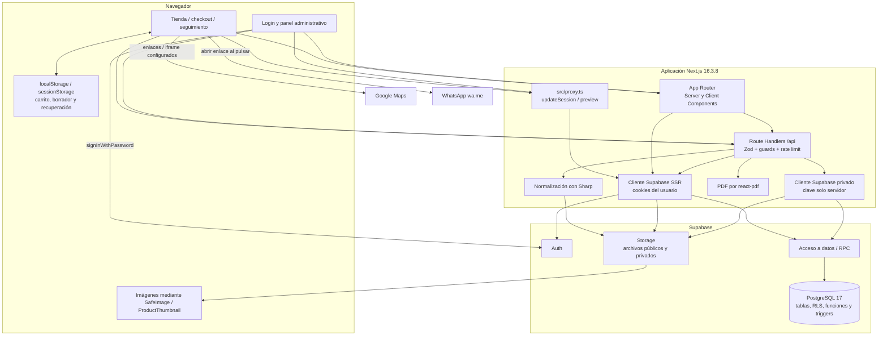

# 02. Tecnologías y arquitectura

## Alcance y grado de certeza

Se analiza el árbol local de PROYECTO FLORERÍA ANABELLE, rama desarrollo-auditoria. La versión de aplicación declarada es 0.1.0 y el nombre del paquete es proyecto-floreria. La marca visible y los informes emplean Floristería Anabelle / NOVA Florería. Son nombres de capas distintas del mismo repositorio, no aplicaciones independientes. Evidencia: [package.json](<C:/Users/carli/OneDrive/Desktop/FLORERIA WEB/proyecto-floreria/package.json:2>), [layout raíz](<C:/Users/carli/OneDrive/Desktop/FLORERIA WEB/proyecto-floreria/src/app/layout.tsx:16>) y [README](<C:/Users/carli/OneDrive/Desktop/FLORERIA WEB/proyecto-floreria/README.md:1>).

Las afirmaciones de este documento se clasifican así:

- **Código/configuración verificados:** archivos presentes y conexiones implementadas; no implican una ejecución satisfactoria de cada caso.
- **Ejecución local comprobada:** metadatos del laboratorio y evidencias de ejecución identificadas explícitamente. No acreditan producción.
- **Antecedente:** informes o commits de rondas previas; sus contadores y certificaciones se conservan en su contexto.
- **No encontrado / pendiente:** una búsqueda estática no encontró la implementación o falta comprobar el entorno externo.

No se modificaron fuentes ni se ejecutaron migraciones para elaborar esta auditoría. La cobertura de páginas y APIs se entrega en ANEXO-indice-codigo.md/.json y el inventario funcional en 03-inventario-funcionalidades.md.

## Plataforma y lenguajes

La aplicación es una **aplicación web cliente-servidor con frontend y backend HTTP integrados en un proyecto Next.js App Router**. Sus módulos se despliegan como una unidad de aplicación Next, mientras Supabase ofrece Auth, acceso a PostgreSQL y Storage. No hay evidencia de microservicios propios separados ni de un servidor Express/Nest adicional.

El lenguaje principal es TypeScript, con TSX para interfaces. También existen CSS, SQL/PLpgSQL para esquema y operaciones de datos, JavaScript ESM en scripts y PowerShell para arrancadores de Windows. El índice actual contabiliza 308 archivos en src, 20 páginas page.tsx y 95 rutas API con 133 handlers HTTP exportados; son cantidades de código, no el número de funciones validadas en producción.

La configuración TypeScript activa strict, noEmit, resolución bundler y alias @/* hacia ./src/*; target ES2017 no equivale a una declaración de navegadores oficialmente soportados. Evidencia: [tsconfig.json](<C:/Users/carli/OneDrive/Desktop/FLORERIA WEB/proyecto-floreria/tsconfig.json:3>).

En esta computadora se observaron Node v24.20.0, npm 11.19.0 y Git 2.55.0.windows.5. El package.json no define engines ni packageManager: esas versiones observadas no son un requisito formal fijado por el proyecto. El paquete Next instalado declara Node >=20.9.0. Falta acordar y fijar una versión de runtime para reproducibilidad; no se modificó la configuración en esta auditoría.

## Dependencias: declaración, resolución y uso

El lockfile npm tiene lockfileVersion 3. “Declarada” es la restricción de package.json; “resuelta” es la versión exacta en package-lock.json. La tabla describe usos encontrados, evitando convertir la mera instalación en una característica comercial. Las versiones reflejan los archivos locales leídos, sin consultar actualizaciones externas ni recomendar cambios.

| Dependencia | Declarada | Resuelta en lock | Grupo | Uso comprobado o alcance |
|---|---|---|---|---|
| @react-pdf/renderer | ^4.9.0 | 4.9.0 | Ejecución | Genera comprobantes y reportes PDF en rutas servidor mediante renderToBuffer. |
| @supabase/ssr | ^0.12.7 | 0.12.7 | Ejecución | Clientes de navegador, servidor y proxy con cookies; autenticación SSR. |
| @supabase/supabase-js | ^2.116.0 | 2.116.0 | Ejecución | Cliente privado para consultas y RPC de servidor; tipos del limitador. |
| class-variance-authority | ^0.7.1 | 0.7.1 | Ejecución | Variantes reutilizables de botones y badges. |
| cn | ^0.2.6 | 0.2.6 | Ejecución | Composición de clases en componentes públicos, administrativos y UI. |
| lucide-react | ^1.42.0 | 1.42.0 | Ejecución | Iconografía de navegación, estados, acciones y componentes. |
| next | 16.3.8 | 16.3.8 | Ejecución | App Router, páginas, Route Handlers, proxy, navegación, fuentes e imágenes. |
| radix-ui | ^1.6.7 | 1.6.7 | Ejecución | Primitivas interactivas de diálogo/menú y accesibilidad, a través de componentes propios. |
| react | ^19.2.8 | 19.2.8 | Ejecución | Renderizado, estado, efectos, contexto y useSyncExternalStore. |
| react-dom | ^19.2.8 | 19.2.8 | Ejecución | Runtime web requerido por React/Next; no hay import directo en src TS/JS. |
| sharp | 0.35.5 | 0.35.5 | Ejecución | Procesamiento real de imágenes de productos, QR y avatar en servidor. |
| tw-animate-css | ^1.4.0 | 1.4.0 | Ejecución | Import CSS en src/app/globals.css:2; la búsqueda de imports TS/JS no lo detecta. |
| zod | ^4.5.4 | 4.5.4 | Ejecución | Validación de payloads, formularios, contratos y configuración. |
| @tailwindcss/postcss | ^4 | 4.3.3 | Desarrollo | Plugin activo en postcss.config.mjs:3. |
| @types/node | ^20 | 20.19.43 | Desarrollo | Tipos de desarrollo; su major 20 no fija la versión de Node ejecutada. |
| @types/react | ^19 | 19.2.18 | Desarrollo | Tipos de desarrollo para React. |
| @types/react-dom | ^19 | 19.2.7 | Desarrollo | Tipos de desarrollo para React DOM. |
| eslint | ^9 | 9.39.5 | Desarrollo | Comando lint y configuración plana; no es una función de la tienda. |
| eslint-config-next | 16.3.8 | 16.3.8 | Desarrollo | Reglas Next core-web-vitals y TypeScript en eslint.config.mjs. |
| shadcn | 4.21.0 | 4.21.0 | Desarrollo | CLI/configuración components.json; además CSS importado en globals.css:3. |
| tailwindcss | ^4 | 4.3.3 | Desarrollo | CSS utilitario importado en globals.css:1 y compilado mediante PostCSS. |
| typescript | ^5 | 5.9.3 | Desarrollo | Comprobación estática estricta; configuración noEmit en tsconfig.json. |
| vitest | ^2.1.9 | 2.1.9 | Desarrollo | Suite __tests__; entorno node en vitest.config.ts, ejecución vitest run. |

Fuentes: [dependencias y scripts](<C:/Users/carli/OneDrive/Desktop/FLORERIA WEB/proyecto-floreria/package.json:5>), [lock npm](<C:/Users/carli/OneDrive/Desktop/FLORERIA WEB/proyecto-floreria/package-lock.json:1>), [PostCSS](<C:/Users/carli/OneDrive/Desktop/FLORERIA WEB/proyecto-floreria/postcss.config.mjs:1>), [CSS global](<C:/Users/carli/OneDrive/Desktop/FLORERIA WEB/proyecto-floreria/src/app/globals.css:1>), [configuración Vitest](<C:/Users/carli/OneDrive/Desktop/FLORERIA WEB/proyecto-floreria/vitest.config.ts:1>) y ANEXO-tecnologias-operacion.json. El anexo guarda versiones y ejemplos de referencias; su búsqueda automática de uso abarca imports/referencias TS/JS dentro de src. CSS, configuración y tests se verificaron por separado. Cero imports directos no significa dependencia inútil.

No se encontró ORM como Prisma, Sequelize, TypeORM o Drizzle entre las dependencias directas. El acceso usa clientes Supabase, select/insert/update y RPC SQL. Tampoco se encontró implementación de un motor 3D, un gateway de cobro automático, login público por OTP o recuperación de contraseña pública. La existencia de opciones de Auth/Realtime/SMTP en la plataforma o de paquetes transitivos no implementa esas pantallas. El inventario 03 y la revisión 08 delimitan cada caso.

## Base de datos, acceso y almacenamiento

El proyecto configura PostgreSQL major 17 en [supabase/config.toml](<C:/Users/carli/OneDrive/Desktop/FLORERIA WEB/proyecto-floreria/supabase/config.toml:41>). La lectura actual del catálogo del **laboratorio local** verificó PostgreSQL 17.11: 38 tablas públicas, 334 columnas, 69 funciones públicas, 90 políticas, 52 triggers y 2 vistas; las 38 tablas tienen RLS. Son metadatos del laboratorio, sin lectura de filas comerciales y sin afirmar equivalencia con producción. El detalle, claves y definición de cada objeto se entrega en 04-base-de-datos.md y ANEXO-catalogo-local-verificado.json. Los metadatos no prueban por sí solos que cada política bloquee correctamente cada operación.

Hay tres fábricas de clientes:

| Fábrica | Dónde corre | Credenciales por nombre | Función |
|---|---|---|---|
| lib/supabase/client.ts | Navegador | NEXT_PUBLIC_SUPABASE_URL y NEXT_PUBLIC_SUPABASE_ANON_KEY | Inicio de sesión de personal y acceso de navegador permitido por Supabase. |
| lib/supabase/server.ts | Servidor Next, con cookies del request | Mismos nombres públicos, más sesión en cookies | Consultas bajo identidad del usuario y renovación de cookies cuando el contexto lo permite. |
| lib/supabase/admin.ts | Rutas/servicios de servidor | NEXT_PUBLIC_SUPABASE_URL y SUPABASE_SECRET_KEY | Operaciones privadas necesarias del backend; no persiste sesión de usuario. |

Evidencia: [cliente navegador](<C:/Users/carli/OneDrive/Desktop/FLORERIA WEB/proyecto-floreria/src/lib/supabase/client.ts:1>), [cliente SSR](<C:/Users/carli/OneDrive/Desktop/FLORERIA WEB/proyecto-floreria/src/lib/supabase/server.ts:1>), [cliente privado](<C:/Users/carli/OneDrive/Desktop/FLORERIA WEB/proyecto-floreria/src/lib/supabase/admin.ts:3>). El cliente privado valida la presencia de variables y configura autoRefreshToken, persistSession y detectSessionInUrl en false. Su autorización depende de las comprobaciones de cada ruta y del contrato SQL; la clave privada no debe publicarse en variables NEXT_PUBLIC.

Las imágenes se guardan como archivos en Supabase Storage y sus metadatos/URLs en tablas. La API de productos procesa bytes con Sharp, sube WebP al bucket product-images y obtiene la URL pública; si falla la inserción posterior intenta compensar retirando el archivo nuevo. El avatar tiene una API privada que obtiene el propietario de la sesión y usa una ruta derivada de su id. Evidencia: [subida de producto](<C:/Users/carli/OneDrive/Desktop/FLORERIA WEB/proyecto-floreria/src/app/api/admin/products/[id]/images/route.ts:309>), [normalización de imagen](<C:/Users/carli/OneDrive/Desktop/FLORERIA WEB/proyecto-floreria/src/lib/product-image-file.ts:1>), [API de avatar](<C:/Users/carli/OneDrive/Desktop/FLORERIA WEB/proyecto-floreria/src/app/api/admin/profile/avatar/route.ts:22>).

Las miniaturas agregadas en pedidos/seguimiento representan la foto actual del producto, no una copia histórica de la fotografía al comprar. Las URLs/metadatos en un dump de base de datos no contienen los bytes de Storage.

## Organización real

| Directorio o archivo | Responsabilidad |
|---|---|
| src/app/page.tsx, checkout/, seguimiento/ | Entradas públicas de tienda, compra y seguimiento. |
| src/app/login/ | Formulario de acceso del personal por correo y contraseña. |
| src/app/admin/ | Páginas administrativas, layout común y estilos admin.css. |
| src/app/api/ | Backend HTTP mediante Route Handlers públicos y administrativos. |
| src/components/public/ | Catálogo, detalle, carrito, checkout, seguimiento y elementos públicos. |
| src/components/admin/ | Componentes por módulo de administración y estructura del panel. |
| src/components/ui/ | Botones, modal, avisos, miniatura y elementos compartidos. |
| src/lib/ | Clientes Supabase, helpers de dominio, reportes, imágenes, horarios, validaciones auxiliares y funciones de presentación. |
| src/validations/ | Esquemas Zod que delimitan entradas y contratos. |
| src/config/ | Navegación administrativa y esquema de configuración pública. |
| src/proxy.ts | Entrada proxy de Next 16: sesión y aislamiento de preview. |
| supabase/migrations/ | Cadena SQL activa; no confundir con migrations-legacy ni ejecutar automáticamente. |
| supabase/migrations-legacy/ | Historial preservado como referencia. |
| supabase/backup/ | Backup manual cifrado de DB y restauración local restringida. |
| scripts/ | Preparadores, arrancadores y QA de laboratorio; varios crean/modifican datos. |
| __tests__/ | Pruebas automatizadas Vitest; predominan helpers, contratos, mocks y markup. |
| docs/ y Markdown de raíz | Decisiones e informes históricos; contienen estados de distintas fechas. |
| public/ | Marca y recursos estáticos públicos. |

No existe una capa de modelos ORM. El dominio se expresa mediante tipos TypeScript, esquemas Zod, consultas Supabase, contratos RPC y tablas/funciones SQL. Las reglas de descuentos, stock, reservas, pagos y caja no deben inferirse solo desde componentes visuales.

## Navegación, identidad y sesión

La portada, checkout y seguimiento son públicos. El visitante compra como invitado; su nombre/celular en el pedido no constituye una cuenta Auth. El formulario /login usa auth.signInWithPassword con correo y contraseña. No se encontró autoservicio público de registro/recuperación/OTP. Evidencia: [login](<C:/Users/carli/OneDrive/Desktop/FLORERIA WEB/proyecto-floreria/src/app/login/page.tsx:22>) y [rutas públicas](<C:/Users/carli/OneDrive/Desktop/FLORERIA WEB/proyecto-floreria/src/lib/supabase/proxy.ts:43>).

El proxy actualiza sesión con createServerClient, sincroniza cookies y consulta getClaims. Solicitudes sin sesión a rutas privadas se redirigen a /login; las rutas públicas se identifican en una lista explícita. El layout admin vuelve a obtener el usuario mediante auth.getUser y consulta profiles con role/is_active. No se limita a confiar en el menú. Las páginas y APIs aplican guards requireEmployeeOrAdmin o requireAdmin según operación. Evidencia: [proxy de sesión](<C:/Users/carli/OneDrive/Desktop/FLORERIA WEB/proyecto-floreria/src/lib/supabase/proxy.ts:27>), [permisos](<C:/Users/carli/OneDrive/Desktop/FLORERIA WEB/proyecto-floreria/src/lib/auth/permissions.ts:28>), [layout admin](<C:/Users/carli/OneDrive/Desktop/FLORERIA WEB/proyecto-floreria/src/app/admin/layout.tsx:19>), [ejemplo de página protegida](<C:/Users/carli/OneDrive/Desktop/FLORERIA WEB/proyecto-floreria/src/app/admin/page.tsx:7>).

Los roles encontrados son administrador y empleado, con is_active. La navegación tiene cuatro grupos y catorce accesos; Usuarios, Configuración y Auditoría solo se incluyen para administrador. El menú no reemplaza la autorización de endpoints. Hay funciones de lectura compartidas con empleado y escrituras más restringidas dentro de ciertos módulos: ver 03 y 08 en lugar de atribuir CRUD completo al empleado por ver una sección.

La navegación se define en [admin-navigation.ts](<C:/Users/carli/OneDrive/Desktop/FLORERIA WEB/proyecto-floreria/src/config/admin-navigation.ts:45>); el estado activo usa la ruta actual. SessionGuard detecta respuestas de mismo origen 401 o redirección a login y muestra expiración de sesión antes de llevar al acceso: [SessionGuard](<C:/Users/carli/OneDrive/Desktop/FLORERIA WEB/proyecto-floreria/src/components/admin/layout/session-guard.tsx:20>). Esta detección mejora la experiencia; los guards de servidor mantienen el control real.

## Circulación de datos y lógica

1. El catálogo y sus filtros consultan endpoints públicos. Los componentes cliente mantienen estado de selección/carrito; createLocalStore usa useSyncExternalStore, localStorage y sincronización entre pestañas, con fallback de memoria si storage no está disponible. No es una base de datos ni una reserva de inventario. Evidencia: [almacén local](<C:/Users/carli/OneDrive/Desktop/FLORERIA WEB/proyecto-floreria/src/lib/public/local-store.ts:19>).
2. Al solicitar compra, el frontend transforma carrito/datos al payload validado. POST /api/orders analiza JSON, valida Zod, aplica rate limit y verifica entrega habilitada antes de invocar create_order con el cliente privado. Recibe el id de pedido del RPC; los importes y consumos deben seguir el contrato servidor/SQL, no confiar en valores visuales. Evidencia: [creación de pedido](<C:/Users/carli/OneDrive/Desktop/FLORERIA WEB/proyecto-floreria/src/app/api/orders/route.ts:12>).
3. El cliente reporta pago; el personal confirma o rechaza mediante acciones administrativas. Un reporte no equivale a una transferencia bancaria comprobada automáticamente. No hay SDK de banco/gateway que confirme un cobro.
4. POST /api/orders/track valida número/teléfono, limita intentos y ejecuta track_order_details. Tras encontrar el pedido obtiene horario y fotos opcionales; responde no-store. Es un POST usado para consulta y puede actualizar contadores del limitador: “lectura funcional” no significa cero escrituras auxiliares. Evidencia: [tracking](<C:/Users/carli/OneDrive/Desktop/FLORERIA WEB/proyecto-floreria/src/app/api/orders/track/route.ts:8>).
5. Reportes y comprobantes se renderizan a PDF mediante @react-pdf/renderer en servidor. No constituye facturación fiscal integrada. Evidencia: [comprobante admin](<C:/Users/carli/OneDrive/Desktop/FLORERIA WEB/proyecto-floreria/src/app/api/admin/orders/[id]/receipt/route.tsx:26>).
6. WhatsApp genera enlaces wa.me; requiere interacción del usuario y no demuestra envío automático. Google Maps construye enlaces/iframe con dirección o coordenadas configuradas; no hay servicio de geocodificación con clave en ese helper. Evidencia: [WhatsApp](<C:/Users/carli/OneDrive/Desktop/FLORERIA WEB/proyecto-floreria/src/lib/public/format.ts:138>), [mapa](<C:/Users/carli/OneDrive/Desktop/FLORERIA WEB/proyecto-floreria/src/lib/public/location-map.ts:3>).

## Diagrama de arquitectura actual

Las flechas resumen llamadas encontradas; no representan procesos autónomos, colas, webhooks bancarios ni sincronización Realtime, que no se encontraron implementados. La consulta a Auth del login se realiza desde el cliente Supabase de navegador; la flecha directa identifica el servicio destino. El control de autorización se revisa de forma específica en 08-seguridad.md.

## Errores y degradación

Las rutas usan respuestas HTTP con success/message y códigos según caso; hay bloques try/catch y validaciones Zod. Algunos módulos contienen estados de carga/error/vacío y avisos compartidos. No se encontró una plataforma externa de observabilidad/error tracking en dependencias directas. El detalle por endpoint queda en el inventario API, evitando afirmar uniformidad total.

El rate limiter llama check_rate_limit de PostgreSQL; si ese mecanismo falla, createOrder, reportPayment, cartAvailability, trackOrder y orderReceipt rechazan la operación. Otras lecturas toleran el fallo según la lista exacta del helper. La IP se obtiene de headers del proxy y necesita una infraestructura de confianza correctamente configurada. Evidencia: [limitador](<C:/Users/carli/OneDrive/Desktop/FLORERIA WEB/proyecto-floreria/src/lib/rate-limit.ts:54>). La auditoría no modificó esos contratos.

El modo de preview visual es un modo aislado: exige flags concordantes, prohíbe configuración Supabase y se bloquea en Production/master; permite GET/HEAD y reescribe APIs a un snapshot visual. No demuestra que la aplicación comercial funcione. El laboratorio real usa otro modo con Supabase local; ambos no se pueden activar juntos. Evidencia: [preview config](<C:/Users/carli/OneDrive/Desktop/FLORERIA WEB/proyecto-floreria/src/lib/visual-preview/config.ts:1>), [proxy](<C:/Users/carli/OneDrive/Desktop/FLORERIA WEB/proyecto-floreria/src/proxy.ts:6>).

## Hosting y reproducibilidad

Existe vercel.json con Git deploymentEnabled false para desarrollo-auditoria y ramas antiguas específicas: [configuración Vercel](<C:/Users/carli/OneDrive/Desktop/FLORERIA WEB/proyecto-floreria/vercel.json:3>). Se encontró configuración de Vercel, **no una verificación actual de hosting/deploy productivo**. Los informes que mencionan un deployment observado describen su propia fecha; no sustituyen comprobar la consola actual. No hay workflow CI activo encontrado en .github en el árbol auditado.

El build previo real fue satisfactorio; la auditoría actual comparó sus 448 entradas con el árbol auditado y encontró 448 hashes idénticos. Esa equivalencia se guarda en ANEXO-equivalencia-build-previo.json; no se volvió a ejecutar build ni se certificó un deployment. La suite y sus límites se describen en 09-pruebas.md. La instalación y ejecución segura están en 13-base-manual-tecnico.md.

