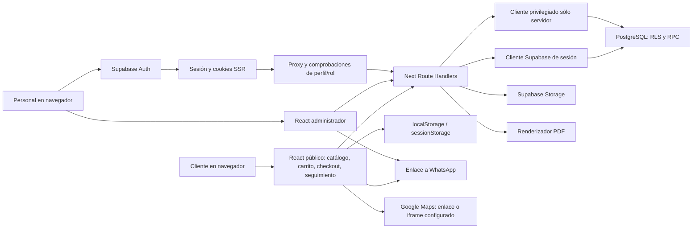

# Informe maestro · Proyecto web Floristería Anabelle

**Corte de la auditoría: 26 de octubre de 2026, America/La_Paz.** Documento de contexto técnico y académico del estado real local. No implementa mejoras ni modifica el código existente.

## 1. Identidad, versión y alcance de la investigación

La marca de la aplicación es **Floristería Anabelle**. El paquete se denomina `proyecto-floreria`, versión declarada `0.1.0`; el README conserva el nombre histórico NOVA Florería. El repositorio indicado por el usuario es `NovaBO56/NOVAFLORERIA`.

La copia inspeccionada está en `C:/Users/carli/OneDrive/Desktop/FLORERIA WEB/proyecto-floreria`, rama **desarrollo-auditoria**, HEAD **7ec66ffc00b0270c878b139bb3bcbd0f91bd84fd**. **Hay cambios locales previos al inicio de la auditoría:** el informe describe ese árbol y no solamente el commit ni el estado remoto. No se hizo commit, push, merge, deploy, migración ni escritura comercial. Los documentos nuevos se agrupan en `documentacion-auditoria`.

Se registraron hashes de 560 archivos no privados antes del análisis; el anexo de integridad compara el estado final. Se indexaron mediante AST **308 archivos fuente**, **20 páginas** y **95 rutas API con 133 métodos HTTP exportados**. El índice incluye funciones nombradas, imports, exports y llamadas literales a APIs/RPC/tablas. Esa cobertura estructural no significa haber ejecutado cada rama, callback anónimo o estado de pantalla.

El inventario agrupa **67 capacidades o ausencias**, separando implementadas por revisión de código, parciales, sólo interfaz y no encontradas. Una dependencia instalada no se considera función; un demo no se considera operación comercial. Las descripciones académicas inferidas o propuestas están expresamente identificadas.

## 2. Qué resuelve y para quién

Es una aplicación web de catálogo, compra asistida y gestión operativa de florería. Integra productos, composiciones y personalizaciones, disponibilidad de materiales, pedidos, avisos de pago, preparación, clientes administrativos, venta presencial, caja, inventario y reportes.

La centralización y trazabilidad son finalidades inferidas del alcance implementado. **No hay evidencia suficiente para afirmar mejoras cuantitativas del negocio**, como reducción de tiempos, aumento de ventas o satisfacción. El proceso anterior y la formulación del problema deben validarse con la florería mediante investigación autorizada.

Actores encontrados:

| Actor | Acceso y capacidades |
| --- | --- |
| Visitante / comprador / cliente | Catálogo, favoritos y carrito locales, personalización, checkout sin cuenta pública, QR/aviso y consulta de un pedido mediante número y celular. |
| Empleado activo | Panel operativo según permiso de página/API/SQL: pedidos, ventas, caja, inventario, catálogo, clientes y reportes; no presume autorización universal por mostrar un menú. |
| Administrador activo | Además usuarios, configuración, auditoría y operaciones restringidas; el sistema protege la permanencia del último administrador activo. |
| Responsable técnico | Responsabilidad operativa de código, entornos, pruebas y respaldo; no es otro valor de rol del sistema. |

El desarrollo es individual según la solicitud. Analista, arquitecto, diseñador, programador, probador y gestor son responsabilidades de la misma persona; los roles académicos simulados no son miembros adicionales de un equipo real.

## 3. Plataforma y arquitectura real

| Tecnología | Versión comprobada en fuentes/lock | Uso identificado |
| --- | --- | --- |
| Next.js | 16.3.8 | App Router, páginas, layouts, proxy, Route Handlers, imágenes y fuentes. |
| React / React DOM | 19.2.8 | Componentes y estado de interfaces públicas/administrativas. |
| TypeScript | 5.9.3 resuelta | Tipos, validaciones y contratos de aplicación; no elimina validación de ejecución. |
| Tailwind CSS | 4.3.3 resuelta | Estilos, utilidades y tokens; CSS adicional separa tema público y administrador. |
| Supabase JS / SSR | 2.116.0 / 0.12.7 | Clientes de navegador, servidor con cookies y cliente privilegiado servidor. |
| PostgreSQL | **17.11 local consultada** | Datos relacionales, restricciones, RLS, funciones de negocio y triggers. |
| Zod | 4.5.4 resuelta | Validación de payloads, consultas y formularios. |
| Radix / Lucide / Sharp | 1.6.7 / 1.42.0 / 0.35.5 resueltas | Modal e interacción accesible; iconos; decodificación y transformación de imágenes. |
| @react-pdf/renderer | 4.9.0 resuelta | Reportes y recibos PDF del servidor. |
| Vitest / ESLint / Git | 2.1.9 / 9.39.5 resueltas; Git observado 2.55.0 | Pruebas, análisis estático y versionado. |

No hay ORM identificado: el acceso usa Supabase/PostgREST y RPC SQL. Tampoco hay un servidor Express separado identificado. Supabase Auth administra autenticación del equipo; la aplicación consulta su perfil y rol. Las contraseñas no se modelan como columnas propias de `profiles`.

Las flechas indican conexiones encontradas, no una certificación del proveedor ni despliegue. La autenticación no es requisito para comprar; las escrituras públicas pasan por APIs Next y funciones privadas del servidor. Las acciones administrativas usan sesión/rol además de controles SQL. El cliente privilegiado puede omitir RLS: su seguridad depende de la validación y autorización previa de la API/RPC correspondiente.

Estructura: `src/app` contiene páginas y APIs; `src/components/public` y `admin` las interfaces; `ui`/`ux` componentes comunes; `src/lib` lógica de compra, autenticación, Supabase, reportes y utilidades; `src/validations` esquemas; `supabase/migrations` cadena SQL activa; `__tests__` pruebas; `scripts` tareas operativas/laboratorios. Las migraciones legacy y el SQL maestro son antecedentes, no otra cadena que deba aplicarse en paralelo.

Hay configuración para Vercel y para ejecución local. **La configuración no acredita un despliegue actualmente publicado ni una URL de producción comprobada.**

## 4. Funcionalidades y contratos que debe conocer otro asistente

### Tienda pública

La portada incluye identidad floral, presentación, información, horario, ubicación y contacto. El catálogo pagina ocho productos por carga, busca y filtra por categorías; permite favoritos locales. El filtro Promociones presenta descuentos y combos dentro del catálogo. El detalle muestra galería, cantidad, opciones y tarjetas por composición. Los complementos son opcionales y tienen selección específica o alternativa global.

Carrito y favoritos persisten en el navegador. Los datos locales se sanitizan; **no son autoridad sobre precio o stock**. Las tarjetas distinguen mensaje/firma de tarjeta física en blanco. Las notas del pedido no se imprimen automáticamente como dedicatoria. La disponibilidad utiliza recetas, componentes, opciones y existencias; la confirmación vuelve a validar en el servidor.

Las promociones son optativas: sugerencia, selección, condición, beneficio estimado, Quitar/Cambiar. Si la composición deja de cumplir la condición, el descuento desaparece y se comunica. La selección de un intento de pedido incierto conserva su contexto original, aunque otra pestaña cambie su promoción.

### Compra, pago y seguimiento

1. El comprador revisa carrito, personalización y promoción.
2. Checkout recoge **nombre y celular del comprador**, luego recojo/entrega, dirección/referencia cuando corresponde y notas.
3. La revisión incluye artículos, tarjetas y total estimado. No hay destinatario independiente ni selector público de fecha/hora.
4. Confirmar invoca `POST /api/orders`; no envía un importe del navegador como autoridad comercial. Hay guardia de doble clic, clave idempotente y recuperación en sesión.
5. El servidor valida esquema, reglas de atención y disponibilidad y llama funciones SQL transaccionales. Una respuesta perdida no debe provocar otro pedido sin intentar recuperar el mismo.
6. Para importes que requieren pago se muestra un QR configurado. La transferencia ocurre fuera de la web.
7. El cliente **reporta** el pago; esto genera un aviso pendiente de revisión y puede abrir WhatsApp con texto preparado. La web no envía el mensaje ni confirma por sí misma el depósito.
8. El personal verifica y confirma/rechaza mediante las acciones autorizadas. Un pedido gratuito no necesita inventar un pago.
9. La preparación avanza por estados controlados y conserva sus efectos en stock/reservas e historial.
10. El cliente consulta número/ID y celular; hay actualización visible cada 45 segundos, que se pausa al fallar o llegar a condiciones terminales.

Estados de pedido representados: `pendiente_pago`, `confirmado`, `en_preparacion`, `listo`, `finalizado`, `cancelado`, `rechazado`. Los estados del pago son distintos; un pago reportado pendiente no equivale a confirmado. El recorrido visual no reconstruye automáticamente etapas de pedidos cancelados/rechazados.

El horario online lo registra el personal como `proposed` o `confirmed`, con control de revisión y confirmación de coordinación; el cliente ve ambos estados en **America/La_Paz**. No hay un botón público de aceptación del horario ni mensaje automático asociado al guardado. El texto de modalidad/dirección se conserva en el contrato `customer_message`; no se inventa un modelo de reparto estructurado que no existe.

La guía descargada es TXT y declara que no es comprobante de pago ni factura. El recibo PDF público usa token y límites de consulta. La referencia de compra anterior de la sesión no es un historial permanente de cuenta.

### Administración y operación

Existen dashboard, pedidos, ventas, inventario, caja, productos, categorías, temporadas, promociones, clientes, reportes, usuarios, configuración y auditoría. El panel SaaS mantiene un tema visual separado de la tienda.

El editor de producto integra datos, fotos, receta, productos incluidos, opciones, complementos y revisión de publicación. Las categorías usan portadas de la configuración existente. El selector visible de carga de logo fue retirado; el contrato de medios aún reconoce ese tipo y puede utilizar una imagen configurada. Esto se documenta como estado del sistema, sin reintroducir la opción.

Las ventas presenciales registran importes y movimientos conforme a sesión/caja y método. Los pedidos online no deben describirse como ingresos en caja física automática. Inventario diferencia flores, insumos, componentes y productos terminados; maneja entradas, mermas, ajustes y lotes FIFO. Una miniatura aparece sólo en una asociación inequívoca de ítem vendible a producto; no se adivina por nombre/SKU ni se ilustra cada insumo puro.

Las devoluciones físicas y los reintegros monetarios conservan la venta original y tienen efectos diferentes. Un registro de reintegro no ejecuta una transferencia bancaria. Los reportes son siete: ventas, caja, inventario, mermas, cancelaciones, clientes y productos vendidos, con JSON/PDF. La lectura del reporte bruto y sus reintegros no debe confundirse con un indicador neto único.

Notificaciones internas y auditoría son componentes operativos, no push del sistema operativo ni email/SMS. El panel consulta notificaciones cada 30 segundos y marca leído mediante acción explícita.

### Lo que no debe atribuirse al sistema

No se encontraron registro/OTP/perfil de cuenta del cliente, recuperación de contraseña en la web, historial público completo de compras, destinatario independiente, pago bancario automático, facturación fiscal, repartidor/GPS, 3D o realidad aumentada. La entrega tiene dirección/referencia para coordinación, sin costo de envío calculado automáticamente. Existe filtro de destacados y consulta `heroProduct`, pero no su uso para renderizar destacados dinámicos en la portada revisada.

`/prueba-cliente` y `/admin/prueba-ui` son demostraciones; sus botones/métricas no acreditan operaciones. El proxy las bloquea en producción. El modo visual sintético tiene banderas y restricciones propias. No confundir ese modo, el laboratorio conectado y producción.

## 5. Base de datos verificada y lo que no se comprobó

Se consultó únicamente estructura en el contenedor **NOVA-LOCAL-CATALOGO-DEMO**, PostgreSQL local asociado al API 50621/DB 50622, mediante `BEGIN TRANSACTION READ ONLY`, SELECT de catálogos y ROLLBACK. No se leyeron pedidos, clientes, pagos, archivos de Storage, claves ni filas de negocio.

Resultado local:

| Elemento | Cantidad |
| --- | --- |
| Tablas públicas | 38, todas con ENABLE RLS; FORCE RLS deshabilitado |
| Columnas | 334 |
| Restricciones / claves foráneas | 231 / 63 |
| Índices públicos | 83 |
| Firmas de funciones públicas | 69, incluidas sobrecargas |
| Funciones SECURITY DEFINER / INVOKER | 60 / 9 |
| Políticas public / storage | 87 / 3 |
| Triggers de usuario públicos | 52 |
| Vistas públicas | 2 |

Entidades principales: `profiles`, `customers`, `categories`, `seasons`, `products`, `product_images`, `customization_options`, requisitos de inventario de producto/opciones, `product_components`, tres tablas de recomendaciones, `promotions`, `promotion_products`, `orders`, `order_items`, `order_discounts`, `payments`, `sale_returns`, `inventory_items`, `inventory_lots`, `inventory_reservations`, entradas/ajustes/mermas/movimientos, `cash_registers`, `cash_sessions`, `cash_movements`, `business_hours`, `system_settings`, `payment_qr_config`, `whatsapp_config`, `notifications`, `order_deletion_requests`, `audit_logs` y `rate_limit_attempts`. El diccionario enumera exactamente las 38 sin convertir vistas en tablas.

Las relaciones, nulabilidad, PK/FK, restricciones, políticas y permisos de ejecución se conservan en los anexos. El ER completo contiene las **63 FK verificadas**. Los modelos de TypeScript son contratos/vistas de aplicación, no clases ORM con persistencia automática.

La cadena versionada activa contiene 20 migraciones. Los defaults y los cuerpos de negocio se analizaron en SQL; esta consulta de catálogo **no extrajo defaults desplegados ni comparó hash de todos los cuerpos de funciones**. El catálogo local no certifica migraciones remotas, producción ni política de respaldo. RLS habilitado no basta por sí solo para declarar seguro todo acceso.

Supabase Storage conserva imágenes y el código determina imágenes públicas de catálogo/configuración y avatar privado. El backup documentado es manual y cifrado para PostgreSQL; **no incluye los archivos físicos de Storage**. No se ejecutó un respaldo/restauración en esta auditoría.

## 6. Seguridad: conclusiones delimitadas

Se revisaron proxy, clientes Supabase, permisos, métodos API, validaciones y controles SQL. El anexo inventaría los 133 métodos con guardas, esquemas, llamadas y límites. Los RPC públicos sensibles se median por servidor; el catálogo local permite comprobar permisos de ejecución. No se concluye que no existan otras vulnerabilidades.

Hallazgos concretos del código, **sin aplicar correcciones**:

1. **Redirección externa posible en `/login` con sesión ya abierta:** la rama del proxy acepta destino que empieza por `/` y lo entrega a `new URL`; valores relativos a protocolo o con separadores equivalentes pueden cambiar el host. El helper del formulario tiene una validación más estricta, pero no protege esa otra rama. La prueba fue pura en memoria, sin visitar un dominio externo. Impacto y recomendación en 08.
2. **Límite de fotografías susceptible a concurrencia:** contar y comprobar la cuota antes de insertar no es una operación atómica ni está respaldada por una restricción equivalente identificada. Es un riesgo de consistencia/cuota entre solicitudes autorizadas; no se hizo una carga concurrente para explotarlo.
3. **Posible archivo huérfano al cargar medios de tienda:** si la subida a Storage tiene éxito y la RPC que registra su referencia falla, el flujo no compensa eliminando el objeto. La condición de fallo se deduce del código; no se indujo contra datos reales.

También se identificó un **presupuesto de entrada no acotado de extremo a extremo**: el máximo de líneas de la UI no está reproducido como máximo del array en el contrato de creación ni en la última función SQL; se parsea JSON antes de validarlo. En determinadas cargas multipart, el tamaño se comprueba después del parseo. Son riesgos de disponibilidad, mitigados parcialmente por frecuencia, autenticación y posibles límites del proveedor; no se hizo una prueba de saturación ni se afirma una explotación productiva.

En capacidad funcional, algunas consultas de directorio/reporte de clientes no paginan todos los resultados. Debe comprobarse su comportamiento cuando superen el máximo de filas configurado de PostgREST. No se fabricó ese volumen de datos ni se observó truncamiento en el escenario actual; queda una tarea con criterio de aceptación.

Hay controles que requieren verificar el despliegue: sobrescritura confiable de cabeceras IP para el limitador, protección uniforme de origen/CSRF en escrituras y cabeceras/CSP efectivas. No se describen como explotación confirmada de producción. Los detalles, ubicación, certeza, prioridad y recomendaciones están en el apartado 08; el tablero no da por implementadas sus soluciones.

## 7. Pruebas y estado funcional: tres niveles de evidencia

| Evidencia | Resultado y alcance |
| --- | --- |
| Revisión actual de código | Estructura, funcionalidades, contratos, validaciones, dependencias, SQL y riesgos. No ejecuta todas las operaciones. |
| Consulta estructural actual | PostgreSQL READ ONLY, metadatos y ACL del laboratorio; no filas comerciales ni migraciones. |
| Prueba actual de URL en memoria | Comprueba resolución del destino del hallazgo de redirect, sin HTTP ni efecto externo. |
| Suite ejecutada previamente | **838 pruebas aprobadas / 77 archivos**, 33,73 s; combinación de lógica pura, mocks, revisión de contratos/fuentes y marcado estático. No equivale a 838 transacciones E2E reales. |
| Lint previo | Exit 0; **0 errores, dos advertencias previas** por img nativa del avatar en líneas 70/77. |
| TypeScript previo | Exit 0, sin emisión ni caché incremental; el log con error anterior al arreglo del fixture se conserva como histórico y no se presenta como éxito. |
| Build previo aislado | `npm run build -- --webpack`, exit 0, 87,50 s, TypeScript integrado y generación de 76 páginas completados. Sin deploy ni modificación del servidor original. |
| Equivalencia de árbol | **448/448 entradas del manifiesto del build previo siguen idénticas**. Sustenta reutilizar la evidencia sin afirmar una nueva ejecución global. |
| Navegador previo | 21 capturas inspeccionadas; producto, carrito, promoción, checkout hasta revisión, seguimiento y áreas administrativas seleccionadas. |
| Geometría previa | 48 observaciones, 12 vistas × cuatro tamaños CSS, sin desborde de documento ni imágenes visibles rotas en las últimas muestras; tablas internas desplazables excluidas del detector. |

El recorrido visual anterior verificó Quitar/Cambiar promoción y pérdida del descuento al retirar el chocolate del combo, dejando total de Bs 240 en ese escenario; luego restauró el carrito vacío. Los seguimientos locales #16/#31 respondieron, con horario propuesto visible donde estaba registrado. No se publican datos de esas personas/pedidos en esta documentación.

Ese recorrido no creó pedidos, no reportó pagos ni guardó configuraciones, subió fotos o registró operaciones de stock. Se observó un HTTP 500 transitorio de Next dev durante recompilación; luego se completó el flujo al reintentar y el build aislado pasó. La consola final de aquel recorrido quedó sin errores/advertencias, lo cual no borra el incidente previo.

No se midió cobertura porcentual formal, carga/concurrencia integral, accesibilidad completa, todos los dispositivos físicos ni despliegue de producción. Las certificaciones históricas del README, como 301 tests/cinco migraciones, se conservan como antecedentes y no sustituyen el estado actual.

## 8. Gestión y continuación del proyecto

El historial demuestra incrementos de backend, integridad/inventario, checkout, catálogo y rediseño/UX; no demuestra una metodología Scrum formal, reuniones, sprints o porcentajes de avance. El Kanban del apartado 10 es una **propuesta de organización individual** basada en evidencia.

Prioridades de continuación propuestas:

- Revisar y corregir los hallazgos documentados con sus pruebas de regresión, una vez autorizado trabajo de implementación.
- Verificar configuración del proxy/hosting, acceso y esquema de producción, sin aplicar una baseline sobre una base existente.
- Completar pruebas controladas de guardados, subidas, creación/recuperación de pedido, pagos, estados, venta/caja y stock; usar laboratorio y datos sintéticos identificados.
- Validar accesibilidad, teclado, dispositivos, fallos de conexión, doble envío y concurrencia de operaciones clave.
- Confirmar requerimientos reales con la florería: entrega/costos, destinatario, teléfonos, cuenta de cliente, recuperación de acceso y necesidad de indicadores netos; no asumir que todas esas ampliaciones son obligatorias.
- Completar estrategia de respaldo de Storage y verificar restauración y responsabilidades operativas.
- Actualizar documentación histórica y preparar manuales con capturas anonimizadas y una versión congelada del sistema.

No se asignan fechas, personas adicionales, estimaciones ni porcentajes no documentados. Las dependencias entre tareas y criterios de cierre figuran en 10 y 14.

## 9. Base académica y manuales

El apartado 11 propone un título y objetivo general con estructura **qué + cómo + para qué**, seis objetivos específicos y una matriz de los 18 apartados del Proyecto Formativo. Se distingue la evidencia del software de la investigación empresarial que falta. No redacta el trabajo final ni inventa bibliografía, entrevistas o resultados cuantitativos.

El apartado 12 describe procedimientos por actor, diferencias entre reportar/confirmar pago y proponer/coordinar horario, problemas comunes y capturas necesarias. El 13 registra versiones, requisitos, instalación, nombres de variables sin valores, ejecución local, build, mantenimiento y precauciones de entorno. No ejecuta preparadores, restauraciones ni migraciones.

## 10. Mapa de documentos y anexos

| Archivo | Contenido |
| --- | --- |
| [01-resumen-general.md](01-resumen-general.md) | Identidad, finalidad, usuarios, alcance y límites. |
| [02-tecnologias-arquitectura.md](02-tecnologias-arquitectura.md) | Versiones declaradas/resueltas/usadas, arquitectura y conexiones reales. |
| [03-inventario-funcionalidades.md](03-inventario-funcionalidades.md) | 67 entradas con los nueve campos solicitados. |
| [04-base-de-datos.md](04-base-de-datos.md) | Esquema local y SQL, entidades/relaciones, seguridad, Storage y ER. |
| [05-requerimientos.md](05-requerimientos.md) | RF/RNF con actor, prioridad, estado, evidencia y aceptación; propuestas separadas. |
| [06-modelado-uml.md](06-modelado-uml.md) | Casos de uso, dominio, secuencia, actividades y componentes actuales. |
| [07-interfaces.md](07-interfaces.md) | Pantallas, diseño, accesibilidad, responsive y validación delimitada. |
| [08-seguridad.md](08-seguridad.md) | Controles, hallazgos y verificaciones pendientes. |
| [09-pruebas.md](09-pruebas.md) | Inventario de pruebas, ejecución previa corroborada y comprobaciones actuales. |
| [10-gestion-y-avances.md](10-gestion-y-avances.md) | Etapas con evidencia, trabajo individual, riesgos y Kanban propuesto. |
| [11-base-proyecto-formativo.md](11-base-proyecto-formativo.md) | Objetivos propuestos y matriz de información/faltantes para 18 apartados. |
| [12-base-manual-usuario.md](12-base-manual-usuario.md) | Procedimientos y plan de capturas reales por usuario. |
| [13-base-manual-tecnico.md](13-base-manual-tecnico.md) | Instalación, configuración, operación, mantenimiento y solución de errores. |
| [14-pendientes-y-recomendaciones.md](14-pendientes-y-recomendaciones.md) | Continuación priorizada, dependencias y límites. |

Los anexos de código, superficie API, pruebas, diccionario SQL, catálogo local, funcionalidades y tecnología proporcionan detalle verificable. El anexo de integridad registra preservación del trabajo anterior y el alcance de los archivos nuevos. Los borradores internos prefijados con `_` no forman parte de la entrega. Las capturas con datos del laboratorio anterior no se copian al paquete académico.

**Regla para reutilizar este informe:** no convertir una propuesta en requerimiento aprobado, una revisión estática en ejecución, una demostración en módulo operativo, un resultado de laboratorio en certificación de producción ni un reporte de pago en transferencia confirmada. Toda mejora posterior debe decidirse y probarse como una tarea separada.
